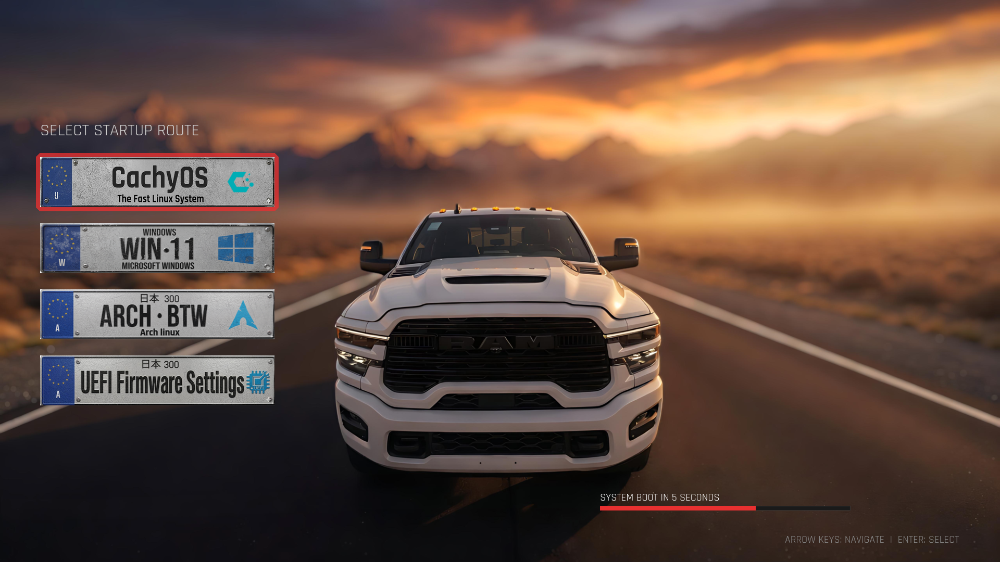
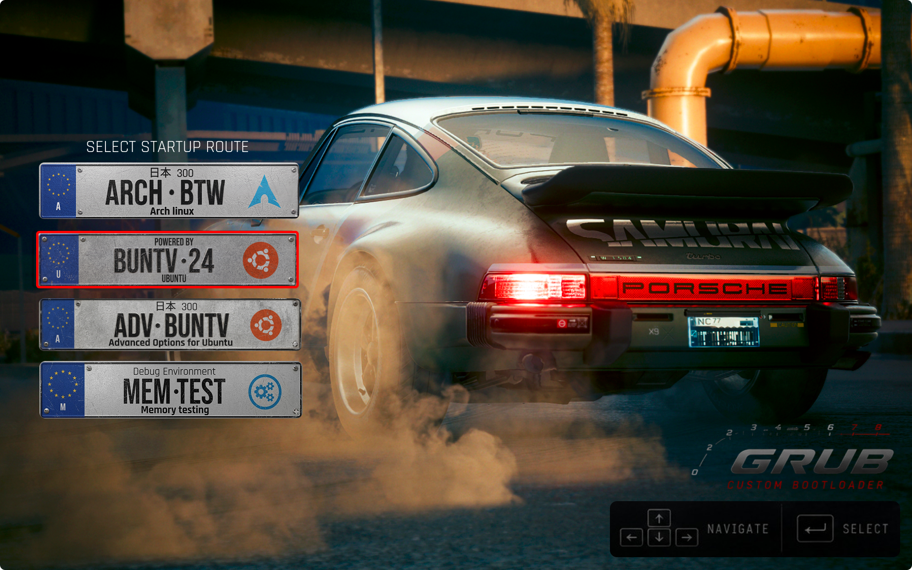
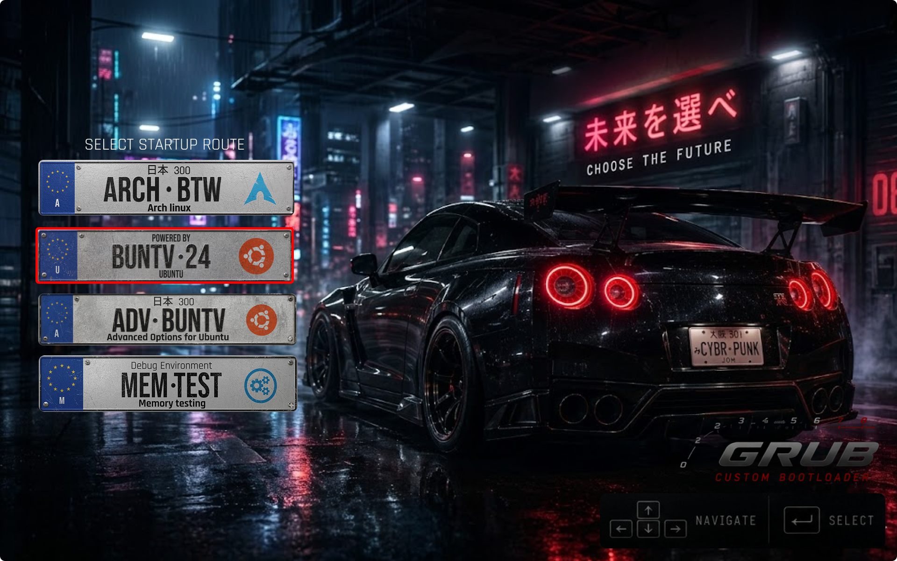
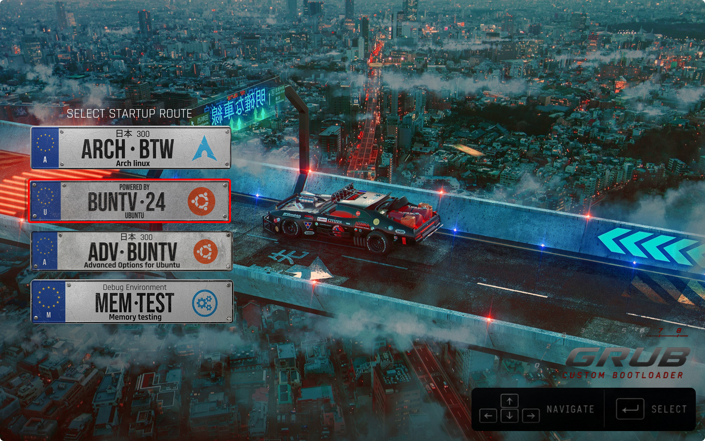
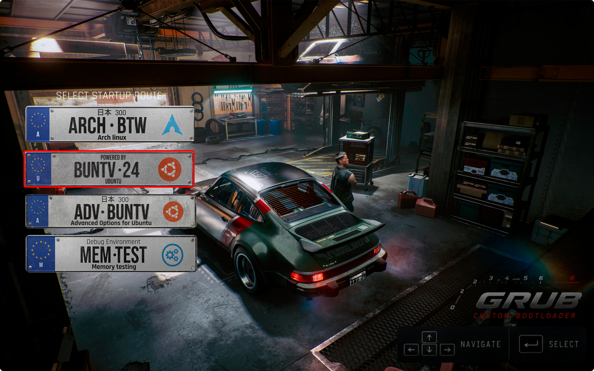

<div align="center">

# 🚗 JDM / Cyberpunk GRUB Theme — RAM Edition

**Um tema de bootloader GRUB inspirado na cultura automotiva JDM e Cyberpunk, com placas de carro customizadas como botões interativos e seleção em glow neon.**

[](https://opensource.org/licenses/MIT)
[](https://www.gnu.org/software/grub/)
[](#)

</div>

---

## 📸 Previews

### RAM Truck Edition (Padrão)
<div align="center">
  
</div>

<br>

### Outros Modelos Disponíveis (Cyberpunk Porsche, GT-R, Garage)
<div align="center">
  
  
  <br>
  
  
</div>

---

## ✨ Características

- **Placas automotivas personalizadas como botões:** Cada sistema operacional (CachyOS, Arch Linux, Ubuntu, Windows 11, UEFI, Memtest) é renderizado como uma placa temática de 450x96px.
- **Seleção com efeito Glow Neon:** Moldura iluminada em vermelho estilo lanterna esportiva ao selecionar itens.
- **Transição suave sem pulos:** Molduras dimensionadas e compensadas com 8px para eliminar qualquer deslocamento de pixel na navegação.
- **Fontes Rajdhani compiladas (.pf2):** Renderizadas nativamente pelo GRUB nas dimensões 20, 24 e 32.
- **Compatibilidade total com Arch / CachyOS / Debian / Ubuntu / Fedora:** Fallbacks automáticos para classes do Linux e Windows.

---

## 🚀 Instalação Rápida

1. **Clone o repositório:**
   ```bash
   git clone https://github.com/AndersonAraujo/JDM-theme-Grub.git
   cd JDM-theme-Grub
   ```

2. **Execute o instalador:**
   ```bash
   sudo ./install.sh
   ```

3. **Pronto!** Reinicie o computador para ver o tema em ação.

---

## 🎨 Como trocar o Wallpaper

Para usar um dos outros wallpapers disponíveis em `assets/backgrounds/`:

1. Copie o wallpaper escolhido para `background.png`:
   ```bash
   cp assets/backgrounds/preview_1.png background.png   # Porsche 911 Cyberpunk
   # ou
   cp assets/backgrounds/preview_2.png background.png   # Nissan GT-R Cyberpunk
   ```
2. Reinstale ou atualize o GRUB:
   ```bash
   sudo ./install.sh
   ```

---

## 🗑️ Desinstalação

Para remover o tema e restaurar o padrão do seu sistema:
```bash
sudo ./install.sh --uninstall
```

---

## 🤝 Créditos & Agradecimentos

- **Fontes:** [Rajdhani](https://fonts.google.com/specimen/Rajdhani) por Indian Type Foundry.
- **Inspiração visual:** Cyberpunk 2077 & Japanese Domestic Market (JDM) plate design.